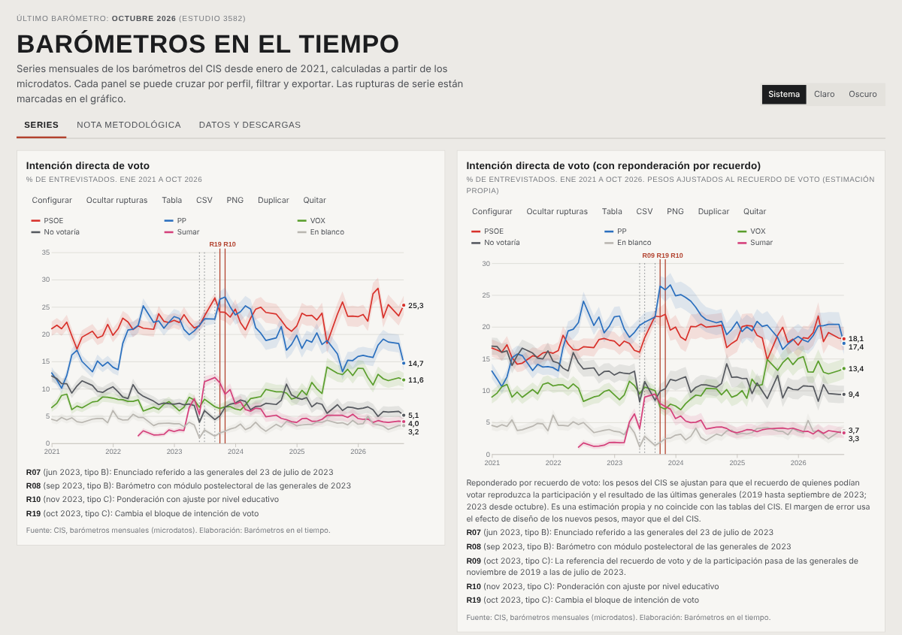
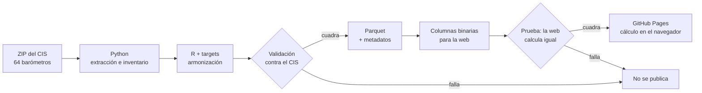

# Barómetro a barómetro

**Las series de los barómetros mensuales del CIS desde 2021, calculadas desde los microdatos.**

### → [gastiaso.github.io/barometros](https://gastiaso.github.io/barometros/)

[](https://gastiaso.github.io/barometros/)

El Centro de Investigaciones Sociológicas (CIS) publica cada barómetro por separado. Entre un mes y otro cambian los enunciados, los códigos de respuesta, la lista de partidos y la ponderación, así que comparar series a mano es lento y fácil de hacer mal. *Barómetro a barómetro* armoniza **64 barómetros (enero de 2021 a octubre de 2026, 264.081 entrevistas)** en un solo fichero y deja construir las series en el navegador: intención de voto, valoración de líderes, problemas, situación económica, ideología… cruzadas por perfil y con cada cambio de método señalado en el gráfico.

## Qué puedes hacer

- **Seguir 27 preguntas mes a mes**: intención directa de voto, voto + simpatía, cercanía, recuerdo de voto, preferencia como presidente del Gobierno, valoración de 9 líderes y 46 ministros, principales problemas de España y problemas que afectan personalmente, situación económica general y personal, autoubicación ideológica, clase social subjetiva, religiosidad…
- **Cruzar y filtrar** por sexo, edad, comunidad autónoma, provincia, tamaño de municipio, estudios, situación laboral, grupo ocupacional, situación profesional, ingresos del hogar, nacionalidad, lugar de nacimiento, clase, religiosidad, ideología, recuerdo de voto o intención de voto.
- **Ver qué cambia en el último barómetro**: un resumen de las diferencias significativas con el anterior.
- **Agrupar respuestas en bloques** (por ejemplo, partidos) y seguir el bloque como una respuesta más.
- **Elegir entre siete gráficos**:
  - evolución mensual, con media móvil opcional;
  - barras apiladas al 100 % para un barómetro;
  - comparación de dos barómetros con significación;
  - mapa de calor;
  - transferencias de voto;
  - dispersión de electorados;
  - mapa por comunidades.
- **Reponderar por recuerdo de voto**, opcionalmente, para ver cuánto cambia la serie cuando el recuerdo se ajusta al resultado real de las últimas generales.
- **Exportar** cada panel como tabla, CSV o PNG, y compartir un enlace con la configuración exacta.
- **Descargar los microdatos armonizados** (Parquet, una fila por entrevista) para trabajar en R, Python o DuckDB.

## En qué se diferencia de copiar las tablas del CIS

- **Parte de los microdatos**, no de los informes. Cualquier cruce se calcula con la ponderación de cada estudio.
- **Las rupturas de serie están documentadas y se ven.** Se han revisado cuestionarios, libros de códigos y fichas técnicas de los 64 estudios. Los cambios que rompen la comparabilidad (un enunciado nuevo, la ponderación por nivel educativo de noviembre de 2023, el nuevo bloque de intención de voto…) se marcan en el gráfico, y no se calculan variaciones a través de ellos.
- **Está validada contra el CIS.** El pipeline reproduce 183 cifras publicadas por el CIS en siete barómetros (de octubre de 2021 a octubre de 2026), y la web recalcula esas mismas cifras en el navegador antes de publicarse. Si alguna deja de cuadrar, la web no se publica.
- **El margen de error es honesto.** Usa el efecto de diseño de cada estudio y nunca muestra un dato con menos de 50 entrevistas.
- **No usa servidor.** El navegador descarga solo las columnas que necesita y hace las cuentas. Nadie registra qué consultas.

> **No es una estimación de voto.** Las series de voto son respuestas directas, no la «estimación» que el CIS calcula con su propio modelo. La reponderación por recuerdo es una estimación propia y no coincide con las tablas del CIS.

## Datos

| Fichero | Contenido |
|---|---|
| [`barometros_armonizados.parquet`](https://gastiaso.github.io/barometros/datos/descargas/barometros_armonizados.parquet) | Una fila por entrevista y una columna por pregunta armonizada, con el peso del CIS y el peso reponderado por recuerdo |
| [`metadatos.json`](https://gastiaso.github.io/barometros/datos/descargas/metadatos.json) | Categorías, rupturas, nivel de comparabilidad de cada pregunta en cada estudio, fechas de campo y efecto de diseño |
| [`inventario/`](inventario/) | Crosswalk revisado, mapas de partidos, problemas y candidatos, rupturas, referencias del CIS usadas en la validación y resultados electorales |

```r
d <- arrow::read_parquet("barometros_armonizados.parquet")
```

```python
import pandas as pd
d = pd.read_parquet("barometros_armonizados.parquet")
```

## Cómo funciona



Todo se ejecuta en GitHub Actions con cada cambio en `main` ([`publicar.yml`](.github/workflows/publicar.yml)).

1. Python extrae los `.sav` y genera el inventario de variables, enunciados y códigos.
2. R armoniza las respuestas con [targets](https://docs.ropensci.org/targets/): partidos y problemas por etiqueta, no por código; no respuesta por tipo (NS, NC, NR, NP); líderes por nombre.
3. R valida el resultado y escribe el fichero de publicación.
4. La web es HTML y JavaScript sin dependencias de servidor, con [d3](https://d3js.org/).
5. Una prueba abre la web en un navegador sin pantalla ([Playwright](https://playwright.dev/python/)) y comprueba que calcula lo mismo que R y que el CIS ([`08_prueba_web.py`](scripts/08_prueba_web.py)).

Para reproducirlo en local, desde la raíz del repositorio:

```sh
python scripts/00_extraer.py .
Rscript -e 'targets::tar_make()'
Rscript scripts/07_web.R
python scripts/08_prueba_web.py .
cd web && python -m http.server
```

El detalle técnico está en [`docs/documentacion_tecnica.md`](docs/documentacion_tecnica.md): estructura del repositorio, ficheros del inventario, niveles de comparabilidad, rupturas y hallazgos sobre los ficheros del CIS. Incluye, por ejemplo, la renumeración de partidos de octubre de 2022 y los errores corregidos en el estudio 3582.

## Actualización

Cuando el CIS publica un barómetro nuevo, se añade su ZIP a `datos/raw/`, se revisa el inventario y se relanza el flujo. La validación impide publicar si la armonización no reproduce las cifras del CIS. 

## Limitaciones

- Las series solo son comparables dentro de cada tramo sin rupturas de tipo C. La web lo respeta, pero la descarga completa no impide comparar lo que no se debe.
- El recuerdo de voto deriva con el tiempo: la reponderación corrige el sesgo de la muestra, pero también arrastra ese desgaste.
- Algunas rupturas documentadas por el CIS, como el cambio de la población de referencia de marzo de 2025, aún no están verificadas en los datos.

Las conclusiones metodológicas son provisionales y se revisan a medida que se amplía la validación.

## Cómo citar

> Astiaso Llamazares, G. (2026). *Barómetro a barómetro: series armonizadas de los barómetros del CIS, 2021-2026* [software y datos]. https://gastiaso.github.io/barometros/. Fuente de los datos: Centro de Investigaciones Sociológicas.

GitHub ofrece la cita en otros formatos (APA, BibTeX) desde el botón *Cite this repository*.

## Fuente y condiciones

**Fuente de los datos: Centro de Investigaciones Sociológicas (CIS)**, barómetros mensuales. Elaboración propia.

Los microdatos se reutilizan según las condiciones generales del CIS: hay que citar la fuente y no desvirtuar el sentido de la información. Este proyecto no está patrocinado por el CIS ni cuenta con su respaldo.

## Licencia

- **Código:** [MIT](LICENSE). Se puede reutilizar con cualquier fin conservando el aviso de autoría.
- **Datos armonizados, metadatos, inventario y documentación:** [CC BY 4.0](https://creativecommons.org/licenses/by/4.0/deed.es). Se pueden reutilizar con cualquier fin citando la autoría.
- **Microdatos originales del CIS:** condiciones de reutilización del CIS.

Detalle y fórmula de cita en [`LICENCIA-DATOS.md`](LICENCIA-DATOS.md).

## Proyectos relacionados

- [opencis](https://github.com/hmeleiro/opencis), de Héctor Meleiro: paquete de R para buscar estudios del CIS y descargar sus microdatos.
- [CEOdata](https://github.com/ceopinio/CEOdata): acceso desde R a los microdatos del Centre d'Estudis d'Opinió de Catalunya.
- [MicroDatosEs](https://github.com/rOpenSpain/MicroDatosEs), de rOpenSpain: lectura de microdatos del INE y otras fuentes oficiales españolas.
