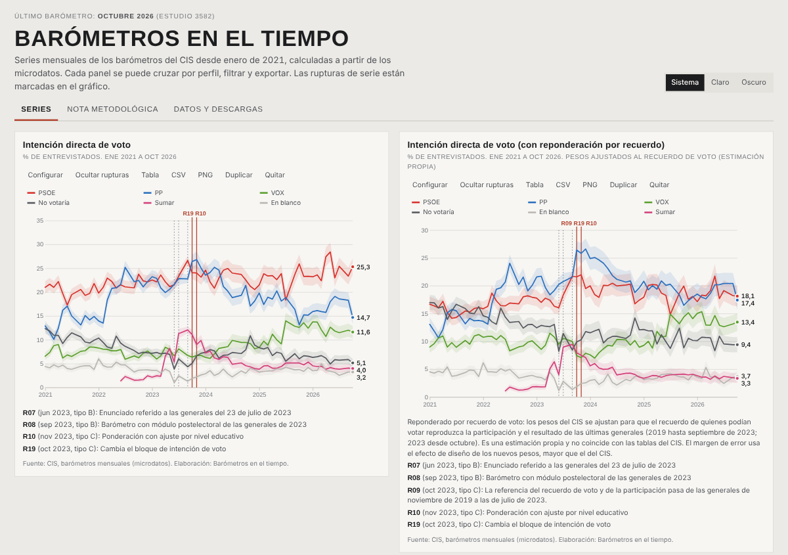
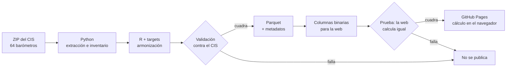

# Barómetro a barómetro

**Las series de los barómetros mensuales del CIS desde 2021, calculadas desde los microdatos.**

### → [gastiaso.github.io/barometros](https://gastiaso.github.io/barometros/)

[](https://gastiaso.github.io/barometros/)

El Centro de Investigaciones Sociológicas (CIS) publica cada barómetro por separado. Entre un mes y otro cambian los enunciados, los códigos de respuesta, la lista de partidos y la ponderación, así que comparar series a mano es lento y fácil de hacer mal. *Barómetro a barómetro* armoniza **64 barómetros (enero de 2021 a octubre de 2026, 264.081 entrevistas)** en un solo fichero y deja construir las series en el navegador: intención de voto, valoración de líderes, problemas, situación económica, ideología… cruzadas por perfil y con cada cambio de método señalado en el gráfico.

## Qué puedes hacer

- **Seguir 27 preguntas mes a mes**: intención directa de voto, voto + simpatía, cercanía, recuerdo de voto, preferencia como presidente del Gobierno, valoración de 9 líderes y 48 ministros, principales problemas de España y problemas que afectan personalmente, situación económica general y personal, autoubicación ideológica, clase social subjetiva, religiosidad…
- **Cruzar y filtrar** por sexo, edad, comunidad autónoma, tamaño de municipio, estudios, situación laboral, grupo ocupacional, situación profesional, ingresos del hogar, nacionalidad, lugar de nacimiento, clase, religiosidad, ideología, recuerdo de voto o intención de voto. La provincia sirve como filtro.
- **Ver qué cambia en el último barómetro**: un resumen de las diferencias significativas con el anterior.
- **Agrupar respuestas en bloques** (por ejemplo, partidos) y seguir el bloque como una respuesta más.
- **Elegir entre ocho gráficos**:
  - evolución mensual, con media móvil opcional;
  - barras apiladas al 100 % para un barómetro;
  - comparación de dos barómetros con significación;
  - mapa de calor;
  - transferencias de voto;
  - dispersión de electorados;
  - mapa por comunidades;
  - cada punto, una entrevista: todas las entrevistas dibujadas una a una, sin ponderar, con el color según dos problemas que cite la persona.
- **Reponderar por recuerdo de voto**, opcionalmente, para ver cuánto cambia la serie cuando el recuerdo se ajusta al resultado real de las últimas generales.
- **Construir tu propia estimación de voto**: eliges cuatro supuestos (base de partida, quién cuenta como votante, qué se hace con quien no sabe a quién votaría y cuánto se corrige por recuerdo) y ves qué estimación sale en cada barómetro, junto al rango de todas las combinaciones y la estimación publicada por el CIS.
- **Exportar** cada panel como tabla, CSV o PNG, y compartir un enlace con la configuración exacta.
- **Descargar los microdatos armonizados** (Parquet, una fila por entrevista) para trabajar en R, Python o DuckDB.

## En qué se diferencia de copiar las tablas del CIS

- **Parte de los microdatos**, no de los informes. Cualquier cruce se calcula con la ponderación de cada estudio.
- **Las rupturas de serie están documentadas y se ven.** Se han revisado cuestionarios, libros de códigos y fichas técnicas de los 64 estudios. Los cambios que rompen la comparabilidad (un enunciado nuevo, la ponderación por nivel educativo de noviembre de 2023, el nuevo bloque de intención de voto…) se marcan en el gráfico, y no se calculan variaciones a través de ellos.
- **Está contrastada con cifras publicadas por el CIS.** El pipeline reproduce 185 cifras de ocho barómetros (de enero de 2021 a octubre de 2026): 181 al redondeo y 4 con una décima de tolerancia, porque el avance de resultados usa una o dos entrevistas más que el fichero. Cubren intención de voto recodificada, voto + simpatía, valoración de líderes y de una ministra, situación económica, ideología y variables de perfil; no hay cifras de referencia para problemas, preferencia como presidente, simpatía, cercanía ni recuerdo, y la cobertura por barómetro es desigual (de 1 a 55 cifras; los otros 56 barómetros solo se validan de forma indirecta, por compartir reglas y código). La web recalcula esas cifras en el navegador antes de publicarse. Si alguna deja de cuadrar, la web no se publica.
- **El margen de error es más realista que el de la ficha técnica.** Incorpora el efecto de diseño de la ponderación de cada estudio (Kish), que la ficha del CIS no recoge; no incorpora el de la estratificación ni el de los conglomerados del muestreo. Nunca muestra un dato con menos de 50 entrevistas.
- **No usa servidor de cálculo.** El navegador descarga solo las columnas que necesita y hace las cuentas. Sin cookies ni analítica; GitHub Pages, que aloja la web, puede registrar qué ficheros se descargan.

> **Las series no son una estimación de voto.** Las series de voto son respuestas directas, no la «estimación» que el CIS calcula con su propio modelo. La reponderación por recuerdo es una estimación propia y no coincide con las tablas del CIS. Las estimaciones están aparte, en «Construye tu estimación», con los supuestos a la vista.

## Construye tu estimación

Una estimación de voto depende de supuestos que la encuesta no fija. La pestaña los separa en cuatro y calcula, en cada barómetro, todas sus combinaciones (240):

| Supuesto | Opciones |
|---|---|
| Base de partida | intención directa (INTENCIONGR); voto + simpatía (VOTOSIMG) |
| Quién cuenta como votante | todos los que declaran voto; probabilidad de ir a votar 8 a 10, 9 o 10, o solo 10; todos, ponderados por su probabilidad (la pregunta existe desde septiembre de 2022) |
| Quien no sabe o no contesta | queda fuera; cascada de preguntas en tres órdenes (simpatía, partido más cercano, recuerdo de voto) o solo simpatía; regresión logística multinomial |
| Corrección por recuerdo | ninguna (peso del CIS), un cuarto, la mitad o completa (`peso_recuerdo`) |

- Sin supuestos elegidos, el gráfico muestra el **rango** de las 240 combinaciones y la estimación del CIS. Cuatro atajos fijan combinaciones de referencia: M1 (voto + simpatía), M2 (M1 corregido por recuerdo), M3 (votantes probables y cascada) y M4 (votantes probables y regresión).
- **Margen de error** al 95 % con el tamaño efectivo de la muestra que dejan los pesos. Comprobado con remuestreo en M1 a M4 (`estimacion/modelos.R`): en los partidos con al menos un 5 %, la mediana de la razón entre el margen por remuestreo y el aproximado va de 0,94 a 0,97 según el atajo, y el 80 % central de los casos queda entre 0,7 y 1,3.
- **Contraste con elecciones**: error de cada combinación en los barómetros de junio y julio de 2023 frente al resultado del 23J y, con los microdatos de 13 encuestas del CIS de 2015 a 2023, frente a cinco generales (`estimacion/historico_armonizar.py` y `estimacion/historico_rejilla.R`; los microdatos se descargan de cis.es con su formulario y no van en el repositorio).
- La estimación del CIS se transcribe de las notas de estimación de cada barómetro (`estimacion/estimacion_cis.csv`, con la dirección de cada documento) y se coteja con una lectura automática de su texto (`estimacion/cotejo_estimacion_cis.py`).
- La rejilla se calcula aparte, porque tarda cerca de una hora: `Rscript estimacion/rejilla.R` (después de `targets::tar_make()`), que escribe `estimacion/rejilla.csv.gz` y `estimacion/rejilla_info.csv.gz`. La publicación solo la pasa a la web (`scripts/07_estimacion.R`). En modo veda la sección se retira.

## Datos

| Fichero | Contenido |
|---|---|
| [`barometros_armonizados.parquet`](https://gastiaso.github.io/barometros/datos/descargas/barometros_armonizados.parquet) | Una fila por entrevista y una columna por pregunta armonizada, con el peso del CIS y el peso reponderado por recuerdo |
| [`metadatos.json`](https://gastiaso.github.io/barometros/datos/descargas/metadatos.json) | Categorías, rupturas, nivel de comparabilidad de cada pregunta en cada estudio, fechas de campo y efecto de diseño |
| [`inventario/`](inventario/) | Crosswalk revisado, mapas de partidos, problemas y candidatos, rupturas, referencias del CIS usadas en la validación y resultados electorales |

```r
d <- arrow::read_parquet("barometros_armonizados.parquet")
```

```python
import pandas as pd
d = pd.read_parquet("barometros_armonizados.parquet")
```

## Cómo funciona



La publicación se ejecuta en GitHub Actions con cada cambio en `main` ([`publicar.yml`](.github/workflows/publicar.yml)): extracción de los `.sav`, armonización y validación en R, datos de la web, prueba e imagen de vista previa. El inventario (pasos 01 a 06 de Python) se regenera en local y se guarda en `inventario/`.

1. Python extrae los `.sav` y genera el inventario de variables, enunciados y códigos.
2. R armoniza las respuestas con [targets](https://docs.ropensci.org/targets/): partidos y problemas por etiqueta, no por código; no respuesta por tipo (NS, NC, NR, NP); líderes por nombre.
3. R valida el resultado y escribe el fichero de publicación.
4. La web es HTML y JavaScript sin dependencias de servidor, con [d3](https://d3js.org/).
5. Una prueba abre la web en un navegador sin pantalla ([Playwright](https://playwright.dev/python/)) y comprueba que calcula lo mismo que R y que el CIS ([`08_prueba_web.py`](scripts/08_prueba_web.py)).

Para reproducirlo en local, desde la raíz del repositorio:

```sh
python scripts/00_extraer.py .
Rscript -e 'targets::tar_make()'
Rscript scripts/07_web.R
Rscript scripts/07_estimacion.R        # usa la rejilla ya calculada (estimacion/rejilla.R)
python scripts/08_prueba_web.py .
python scripts/09_vista_previa.py .
cd web && python -m http.server
```

El detalle técnico está en [`docs/documentacion_tecnica.md`](docs/documentacion_tecnica.md): estructura del repositorio, ficheros del inventario, niveles de comparabilidad, rupturas y hallazgos sobre los ficheros del CIS. Incluye, por ejemplo, la renumeración de partidos de octubre de 2022 y los errores corregidos en el estudio 3582.

## Actualización

Cuando el CIS publica un barómetro nuevo, se añade su ZIP a `datos/raw/`, se revisa el inventario y se relanza el flujo. La validación impide publicar si la armonización no reproduce las cifras del CIS. Una etiqueta `vAAAA-MM` sobre el commit publicado crea una versión de los datos con los ficheros adjuntos (`.github/workflows/version.yml`). Los cambios de método y de datos quedan anotados en [`CHANGELOG.md`](CHANGELOG.md); cómo proponer correcciones, en [`CONTRIBUTING.md`](CONTRIBUTING.md). 

## Limitaciones

- Las series solo son comparables dentro de cada tramo sin rupturas de tipo C. La web lo respeta, pero la descarga completa no impide comparar lo que no se debe.
- El recuerdo de voto deriva con el tiempo: la reponderación corrige el sesgo de la muestra, pero también arrastra ese desgaste.
- En las preguntas de problemas, cuántos cita cada persona ha subido con los años sin cambio de enunciado (R30): las series que suman las tres menciones tienen una deriva mecánica al alza; la primera mención es la serie comparable.
- Algunas rupturas documentadas por el CIS están verificadas solo a grandes rasgos: el cambio de la población de referencia de marzo de 2025 (R24) se ve en los márgenes de edad del peso (menos de un punto), pero no se ha medido su efecto serie a serie.

Las conclusiones metodológicas son provisionales y se revisan a medida que se amplía la validación.

## Cómo citar

> Astiaso Llamazares, G. (2026). *Barómetro a barómetro: series armonizadas de los barómetros del CIS, 2021-2026* [software y datos]. https://gastiaso.github.io/barometros/. CC BY 4.0. Origen de los datos: Centro de Investigaciones Sociológicas (CIS), barómetros mensuales (microdatos).

Añade el último barómetro incluido (aparece arriba en la web) y la fecha de consulta. Para citar una versión concreta de los datos, las [versiones publicadas](https://github.com/gastiaso/barometros/releases) (`vAAAA-MM`, el último barómetro incorporado) llevan adjuntos el Parquet, los metadatos y el inventario tal como se construyeron desde ese commit, con sus sumas SHA-256.

GitHub ofrece la cita en otros formatos (APA, BibTeX) desde el botón *Cite this repository*.

## Fuente y condiciones

**Origen de los datos: Centro de Investigaciones Sociológicas (CIS)**, barómetros mensuales. Elaboración propia.

Los microdatos se reutilizan según las [condiciones generales del CIS](https://www.cis.es/es/aviso-legal): citar la fuente, mencionar la fecha de actualización y no desvirtuar el sentido de la información. Este proyecto no está patrocinado por el CIS ni cuenta con su respaldo.

## Licencia

- **Código:** [MIT](LICENSE). Se puede reutilizar con cualquier fin conservando el aviso de autoría.
- **Datos armonizados, metadatos, inventario, documentación y textos de la web:** [CC BY 4.0](https://creativecommons.org/licenses/by/4.0/deed.es). Se pueden reutilizar con cualquier fin citando la autoría.
- **Microdatos originales del CIS:** condiciones de reutilización del CIS.

Detalle y fórmula de cita en [`LICENCIA-DATOS.md`](LICENCIA-DATOS.md).

## Proyectos relacionados

- [opencis](https://github.com/hmeleiro/opencis), de Héctor Meleiro: paquete de R para buscar estudios del CIS y descargar sus microdatos.
- [CEOdata](https://github.com/ceopinio/CEOdata): acceso desde R a los microdatos del Centre d'Estudis d'Opinió de Catalunya.
- [MicroDatosEs](https://github.com/rOpenSpain/MicroDatosEs), de rOpenSpain: lectura de microdatos del INE y otras fuentes oficiales españolas.
